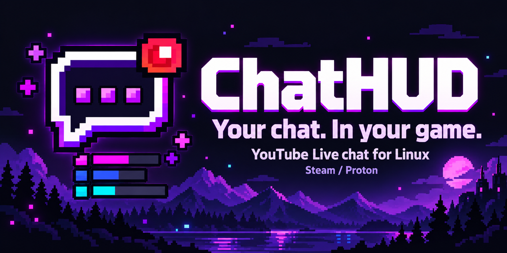
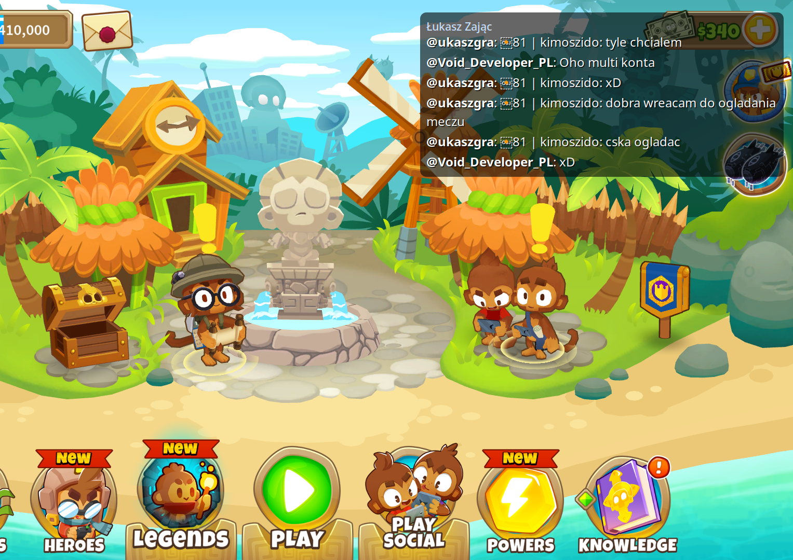

[Polski](README_PL.md) · [Changelog](CHANGELOG.md)

# ChatHUD

ChatHUD displays YouTube Live and Twitch chat over Linux games. The overlay is written in C; a separate Qt app handles profiles, appearance and Steam launch options. You can close the settings app while playing.

**Version 0.7.0 — early alpha.** The overlay uses X11/XWayland. There is no Flatpak or AppImage package yet; installation builds the program from source.

- YouTube Live URLs and Twitch channel URLs, detected automatically.
- Per-game profiles with their own stream URL, monitor and appearance settings.
- Click-through chat with wrapped messages, adjustable fonts, background opacity and nine positions within the selected monitor.
- English and Polish interface, switchable without restarting the panel.
- Steam/Proton launcher and optional MangoHud integration.



*In-game screenshot from an earlier build.*

## Install

### Dependencies

Arch Linux / EndeavourOS:

```bash
sudo pacman -S --needed \
  git base-devel pkgconf python pyside6 qt6-svg \
  libx11 libxrandr libxfixes libxext cairo pango \
  curl json-c libjpeg-turbo libwebp yt-dlp
```

Debian 13 / Ubuntu 26.04:

```bash
sudo apt update
sudo apt install \
  git build-essential pkg-config python3 \
  python3-pyside6.qtwidgets python3-pyside6.qtsvg \
  libx11-dev libxrandr-dev libxfixes-dev libxext-dev \
  libcairo2-dev libpango1.0-dev libcurl4-openssl-dev \
  libjson-c-dev libjpeg-dev libwebp-dev yt-dlp
```

The PySide6 packages are in Ubuntu's Universe repository. For older distributions without those packages, see the Python environment instructions below. `yt-dlp` is needed for the default YouTube backend; Twitch chat uses libcurl directly.

### Download and build

```bash
git clone https://github.com/DevVoidPL/ChatHud.git
cd ChatHud
./install.sh
```

Run the installer as your regular user. It builds the overlay and installs ChatHUD under `~/.local`, including an application-menu entry. Existing settings are preserved.

You can also use **Code → Download ZIP**, extract the archive and run `bash install.sh` in the extracted folder. The ZIP contains source code, so the build dependencies are still required.

Launch **ChatHUD** from the application menu or run:

```bash
~/.local/bin/chathud-gui
```

<details>
<summary>Older Debian / Ubuntu: install PySide6 in a separate Python environment</summary>

Install the same native build dependencies listed above, leaving out `python3-pyside6.qtwidgets` and `python3-pyside6.qtsvg`. Add `python3-venv`, then use Python 3.10 or newer:

```bash
sudo apt install python3-venv
CHATHUD_VENV="${XDG_DATA_HOME:-$HOME/.local/share}/chathud/venv"
python3 -m venv "$CHATHUD_VENV"
"$CHATHUD_VENV/bin/python" -m pip install 'PySide6>=6.5,<7'
```

The launcher uses this environment automatically when it exists, including when opened from the application menu. Otherwise it uses system Python.

</details>

## Set up a game

1. Choose **English** or **Polski** in the upper-right corner. The app remembers your choice.
2. Paste a YouTube Live URL, such as `https://www.youtube.com/watch?v=VIDEO_ID`, or a Twitch channel URL, such as `https://www.twitch.tv/channel_name`.
3. Choose the monitor and chat position, then adjust the appearance.
4. **Desktop demo** shows sample messages. **Connect to chat** opens the supplied chat. The square stop button ends the preview.
5. Click **Copy command**. Paste it into **Steam → game → Properties → General → Launch Options**.

If you already have launch options, merge them manually before pasting. Use **Add profile** for another game. Profiles store the URL, so changing streams later only requires saving the same profile and restarting the overlay; the Steam command stays the same.

A default-profile command looks like this:

```bash
$HOME/.local/bin/chathud-steam --config "$HOME/.config/chathud/config" -- %command%
```

With MangoHud installed:

```bash
$HOME/.local/bin/chathud-steam --config "$HOME/.config/chathud/config" -- mangohud %command%
```

For an overlay without a game:

```bash
~/.local/bin/chathud --url "https://www.twitch.tv/channel_name" --no-game
```

## YouTube and Twitch

**YouTube** uses `yt-dlp` by default. An optional YouTube Data API backend accepts your own API key. YouTube custom emoji are supported.

**Twitch** uses an anonymous, read-only IRC connection over TLS. It handles incoming messages, reconnects, keepalive messages and chat deletions. It does not send chat messages. Use a channel URL; VOD and clip URLs are not supported. Twitch emote names are displayed as text for now; emote images and BTTV/FFZ/7TV are not implemented.

The backend is chosen from the URL. The **YouTube backend** selector only applies to YouTube. Twitch does not need `yt-dlp` or a YouTube API key. Anonymous Twitch access depends on Twitch continuing to allow it; a refused login is shown in the overlay.

## Settings

- `~/.config/chathud/config` — default profile.
- `~/.config/chathud/profiles/*.conf` — game profiles.
- `~/.config/chathud/profiles.json` — profile names and MangoHud selection.
- `~/.config/chathud/ui.json` — interface language.
- `~/.cache/chathud/steam-wrapper.log` — Steam launcher log.

These paths respect `XDG_CONFIG_HOME`, `XDG_DATA_HOME` and `XDG_CACHE_HOME`. All options are listed in [config.example](config.example). For example:

```ini
stream_url=https://www.twitch.tv/channel_name
language=en
monitor=primary
position=top-right
width=700
lines=6
font_size=18
background_opacity=0.62
```

`language` controls the overlay's built-in messages; the desktop app writes it when saving a profile. Chat messages are not translated. Use `background_opacity=0` for text without the dark panel. Saved changes apply when the overlay next starts.

## If something goes wrong

- **Build fails:** install the development packages above, including headers.
- **App cannot find PySide6:** install the distro bindings or use the separate environment above.
- **Wrong monitor:** choose the display, save the profile and restart the overlay. A disconnected display falls back to the primary one.
- **No overlay on Wayland:** check that XWayland is running and `DISPLAY` is set. Visibility above native Wayland games depends on the compositor.
- **YouTube chat is empty:** check the live URL, whether chat is enabled, and your `yt-dlp` version.
- **Twitch chat is empty:** check the channel URL and the connection status in the overlay.
- **Steam problem:** check the launcher log. The app's **Diagnostics** button shows paths and missing dependencies.

For bug reports, include your distro, X11/Wayland session, version and relevant log output. Remove API keys before sharing logs.

## Update or remove

From a Git checkout without local code changes:

```bash
git pull --ff-only
./install.sh
```

Close and reopen the panel and overlay after an update. For a ZIP installation, download the new source and run its installer.

To uninstall, run `make uninstall` in the source folder. This removes app files and the optional app-local Python environment. Profiles and cache files remain.

[MIT License](LICENSE)
