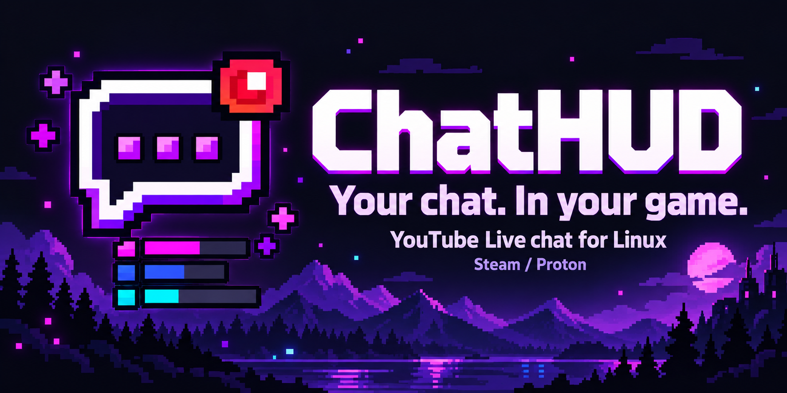
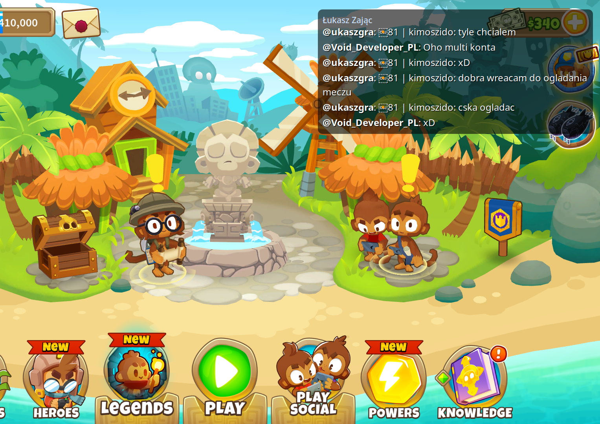

<p align="center">
  
</p>

<p align="center">
  <a href="README.md">English</a> · <strong>Polski</strong><br />
  <a href="#instalacja">Instalacja</a> · <a href="#pierwsze-uruchomienie">Pierwsze uruchomienie</a> · <a href="#opcje-uruchamiania-steam">Steam</a> · <a href="#rozwiązywanie-problemów">Pomoc</a> · <a href="CHANGELOG.md">Historia zmian</a>
</p>

# ChatHUD

**Czat YouTube Live widoczny podczas gry.**

ChatHUD wyświetla przezroczysty panel czatu nad grą w Linuksie. Wklej link do transmisji, wybierz monitor i zapisz profil gry w aplikacji graficznej. Podczas gry działa natywny overlay napisany w C; panel ustawień Qt możesz zamknąć.

To narzędzie do śledzenia czatu na ekranie, z którego już korzystasz — z launcherem Steam/Proton i opcjonalną obsługą MangoHud. Overlay przepuszcza kliknięcia do gry.

> **Wersja 0.6.1 · wczesna alpha.** Obecnie instalacja odbywa się z kodu źródłowego. Flatpak, AppImage i oficjalne paczki dystrybucji są w planach. Overlay w sesji Wayland korzysta z XWayland.

## Co oferuje aplikacja

| Funkcja | Do czego służy |
| --- | --- |
| **YouTube Live** | Link do publicznej transmisji wystarczy przy użyciu `yt-dlp`; klucz Google API jest opcjonalny. |
| **Graficzny panel po polsku** | Ustawianie wyglądu, podgląd, sprawdzenie zależności i kopiowanie komendy Steam. |
| **Profile gier** | Osobny link i wygląd czatu dla każdej gry. |
| **Wybór monitora** | Pozycja czatu jest liczona względem wybranego ekranu. |
| **Czytelne wiadomości** | Zawijanie tekstu, nazwa kanału, rozmiary czcionek, krycie tła, wyrównanie i kolejność. |
| **Emotki** | Własne emotki YouTube z pamięcią podręczną oraz tekst Unicode. |
| **Steam / Proton** | Osobny launcher uruchamia overlay z bibliotekami systemu, zachowując środowisko gry. |

### Przykład podczas gry



*Rzeczywisty zrzut z wcześniejszej wersji. Grafika w nagłówku jest ilustracją promocyjną.*

## Instalacja

Potrzebujesz Linuksa, kompilatora C, Pythona 3.10+ do panelu graficznego i bibliotek podanych poniżej. Overlay wymaga X11 lub XWayland. `yt-dlp` pobiera czat, a MangoHud jest dodatkiem opcjonalnym.

### 1. Zainstaluj zależności

<details open>
<summary><strong>Arch Linux / EndeavourOS</strong></summary>

```bash
sudo pacman -S --needed \
  git base-devel pkgconf python pyside6 qt6-svg \
  libx11 libxrandr libxfixes libxext cairo pango \
  curl json-c libjpeg-turbo libwebp yt-dlp
```

</details>

<details>
<summary><strong>Debian 13 / Ubuntu 26.04</strong></summary>

```bash
sudo apt update
sudo apt install \
  git build-essential pkg-config python3 \
  python3-pyside6.qtwidgets python3-pyside6.qtsvg \
  libx11-dev libxrandr-dev libxfixes-dev libxext-dev \
  libcairo2-dev libpango1.0-dev libcurl4-openssl-dev \
  libjson-c-dev libjpeg-dev libwebp-dev yt-dlp
```

W Ubuntu pakiety PySide6 są w repozytorium **Universe**. Na starszych wydaniach dostępność pakietów może się różnić — wtedy skorzystaj z wariantu poniżej.

</details>

<details>
<summary><strong>Starszy Debian / Ubuntu — osobne środowisko Pythona dla panelu</strong></summary>

Zainstaluj biblioteki i narzędzia do budowy:

```bash
sudo apt update
sudo apt install \
  git build-essential pkg-config python3 python3-venv \
  libx11-dev libxrandr-dev libxfixes-dev libxext-dev \
  libcairo2-dev libpango1.0-dev libcurl4-openssl-dev \
  libjson-c-dev libjpeg-dev libwebp-dev yt-dlp
```

Korzystając z Pythona 3.10 lub nowszego, utwórz środowisko Qt dla ChatHUD:

```bash
CHATHUD_VENV="${XDG_DATA_HOME:-$HOME/.local/share}/chathud/venv"
python3 -m venv "$CHATHUD_VENV"
"$CHATHUD_VENV/bin/python" -m pip install 'PySide6>=6.5,<7'
```

Launcher `chathud-gui` automatycznie użyje tego środowiska, także przy uruchamianiu z menu aplikacji. Gdy go nie ma, korzysta z systemowego Pythona. Instalacja nie wymaga `sudo pip`.

</details>

### 2. Pobierz i zainstaluj ChatHUD

```bash
git clone https://github.com/DevVoidPL/ChatHud.git
cd ChatHud
./install.sh
```

Uruchom `./install.sh` jako zwykły użytkownik. Skrypt buduje overlay, instaluje launchery i wpis w menu oraz zachowuje istniejącą konfigurację. Uprawnień `sudo` wymagają wcześniejsze polecenia instalujące zależności.

**Wolisz ZIP?** Na stronie repozytorium kliknij **Code → Download ZIP**, rozpakuj archiwum i otwórz terminal w rozpakowanym folderze. Po zainstalowaniu zależności wykonaj `bash install.sh`. ZIP zawiera kod źródłowy, który również trzeba zbudować.

### 3. Otwórz aplikację

W menu Linuksa wyszukaj **ChatHUD** albo wykonaj:

```bash
~/.local/bin/chathud-gui
```

## Pierwsze uruchomienie

1. W polu **Transmisja** wklej link do konkretnego live’a na YouTube.
2. Wybierz ekran w polu **Monitor**. Przycisk **↻** odświeża listę po zmianie układu monitorów.
3. Ustaw pozycję, szerokość, rozmiar tekstu, liczbę wiadomości i krycie tła. W zakładce **Zaawansowane** są wyrównanie, kolejność, emotki i opcjonalne YouTube API.
4. **Test na pulpicie** pokazuje przykładowe wiadomości bez gry i internetu. **Połącz z live’em** pobiera prawdziwy czat. Przycisk **■** zatrzymuje podgląd.
5. Kliknij **Kopiuj komendę** i wklej wynik w **Steam → gra → Właściwości → Ogólne → Opcje uruchamiania**.

**Przy kolejnym live zmień link i zapisz ten sam profil. Komenda w Steam zostaje taka sama.** Ustawienia są wczytywane przy uruchamianiu overlaya — po zapisaniu zmian uruchom podgląd lub grę ponownie.

**Dodaj profil** pozwala wybrać lokalnie wykrytą grę Steam lub wpisać własną nazwę. Nowy profil przejmuje zapisane ustawienia bieżącego profilu, a następnie ma własną konfigurację. Aplikacja odczytuje nazwy gier; opcje uruchamiania w Steam wklejasz samodzielnie.

## Opcje uruchamiania Steam

Panel generuje komendę dla wybranego profilu i poprawnie cytuje ścieżki ze spacjami. Jeśli masz już własne opcje, połącz je ręcznie przed wklejeniem.

Przykład dla profilu domyślnego:

```bash
$HOME/.local/bin/chathud-steam --config "$HOME/.config/chathud/config" -- %command%
```

Z zainstalowanym MangoHud:

```bash
$HOME/.local/bin/chathud-steam --config "$HOME/.config/chathud/config" -- mangohud %command%
```

Możesz też podać link bezpośrednio. `--url` ma pierwszeństwo przed `stream_url` zapisanym w profilu:

```bash
$HOME/.local/bin/chathud-steam --url "https://www.youtube.com/watch?v=VIDEO_ID" -- %command%
```

Overlay bez uruchamiania gry:

```bash
~/.local/bin/chathud --url "https://www.youtube.com/watch?v=VIDEO_ID" --no-game
```

## Ustawienia i pliki

| Domyślna lokalizacja | Zawartość |
| --- | --- |
| `~/.local/bin/chathud` | Natywny overlay |
| `~/.local/bin/chathud-steam` | Launcher Steam/Proton |
| `~/.local/bin/chathud-gui` | Launcher panelu ustawień |
| `~/.local/share/chathud/` | Panel, ikona i opcjonalne środowisko Pythona |
| `~/.config/chathud/config` | Profil domyślny |
| `~/.config/chathud/profiles/*.conf` | Profile gier |
| `~/.config/chathud/profiles.json` | Nazwy profili i wybór MangoHud |
| `~/.cache/chathud/steam-wrapper.log` | Log launchera Steam |

Obsługiwane są `XDG_CONFIG_HOME`, `XDG_DATA_HOME` i `XDG_CACHE_HOME`. Instalator zachowuje istniejący profil domyślny. Panel zachowuje komentarze i nieznane ustawienia w konfiguracji; pliki profili i ich metadane są zapisywane atomowo z prywatnymi uprawnieniami.

Pełną listę ustawień zawiera [config.example](config.example). Typowy profil:

```ini
stream_url=https://www.youtube.com/watch?v=VIDEO_ID
provider=auto
monitor=primary
position=top-right
width=700
lines=6
font_size=18
background_opacity=0.62
```

`background_opacity=0` usuwa tło panelu. Monitor wybierzesz w GUI albo odczytasz jego nazwę przez `~/.local/bin/chathud --list-monitors`. Po odłączeniu zapisanego ekranu overlay użyje głównego monitora, a gdy żaden nie jest oznaczony jako główny — pierwszego aktywnego.

<details>
<summary><strong>Opcjonalne oficjalne YouTube Data API</strong></summary>

Wybierz **Źródło czatu → YouTube API** i podaj własny klucz albo wpisz w profilu:

```ini
provider=api
youtube_api_key=YOUR_API_KEY
```

`provider=auto` wybiera `yt-dlp`, jeśli jest dostępny. W przeciwnym razie próbuje oficjalnego API, które wymaga prawidłowego klucza.

</details>

## Rozwiązywanie problemów

| Objaw | Co sprawdzić |
| --- | --- |
| Budowanie zgłasza brak biblioteki | Zainstaluj zależności z sekcji instalacji, w tym pakiety deweloperskie z nagłówkami. |
| Panel zgłasza brak PySide6 | Zainstaluj pakiety Qt dystrybucji albo utwórz opisane wyżej środowisko Pythona. |
| Czat jest na złym ekranie | Wybierz **Monitor**, zapisz profil i uruchom overlay ponownie. |
| Overlay jest niewidoczny na Wayland | Sprawdź XWayland i zmienną `DISPLAY`. Widoczność nad natywnymi grami Wayland zależy od kompozytora. |
| Brak wiadomości | Sprawdź link, dostępność czatu na transmisji i wersję `yt-dlp`. Zajrzyj do **Diagnostyka**. |
| Problem z uruchomieniem przez Steam | Sprawdź `~/.cache/chathud/steam-wrapper.log`. |
| Na pasku została stara przypięta ikona | Zamknij aplikację, uruchom **ChatHUD** z menu i przypnij aktualny launcher. |

Zgłaszając problem, podaj dystrybucję, sesję X11/Wayland, wersję ChatHUD, istotny komunikat z terminala i log launchera Steam. Usuń z logów klucze API oraz inne prywatne dane przed ich udostępnieniem.

## Aktualizacja i odinstalowanie

W kopii pobranej przez Git, bez własnych zmian w kodzie:

```bash
cd ChatHud
git pull --ff-only
./install.sh
```

Przed aktualizacją zamknij panel i overlay, a po niej otwórz je ponownie. Profile zostaną zachowane. Przy instalacji z ZIP pobierz i rozpakuj nowy kod, a następnie uruchom jego instalator.

Odinstalowanie z katalogu źródeł:

```bash
make uninstall
```

Usuwa pliki aplikacji oraz opcjonalne środowisko Pythona w jej katalogu danych. Ustawienia i pamięć podręczna pozostają w lokalizacjach z tabeli.

## Obecny zakres i plany

ChatHUD obsługuje **YouTube Live w Linuksie przez X11/XWayland**. Jest zewnętrznym overlayem, a jego widoczność w konkretnej grze zależy od systemu okien i kompozytora. Pobieranie czatu zależy również od zmian w YouTube i aktualności `yt-dlp`.

W planach są natywna obsługa Wayland, Twitch i jego emotki, skrót pokazywania/ukrywania czatu, wygaszanie wiadomości, bogatsze odznaki i łatwiejsza instalacja przez paczki lub Flatpak. To planowane kierunki rozwoju.

Kod renderera jest w C, a panel ustawień korzysta z Pythona i PySide6. Repozytorium zawiera sprawdzenia regresji uruchamiane przez `make test`; opis wersji znajdziesz w [CHANGELOG.md](CHANGELOG.md).

Projekt udostępniono na [licencji MIT](LICENSE).
